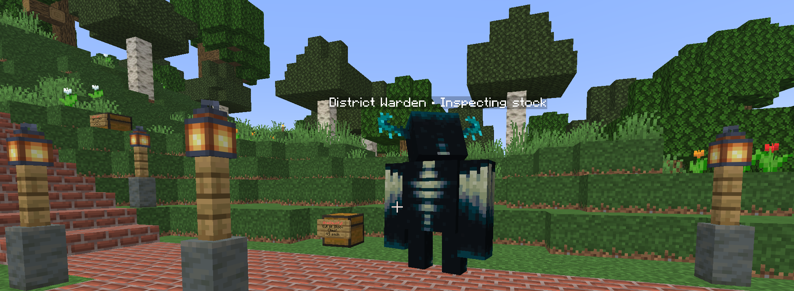

import Persona from '@site/src/components/Persona';

# The District Warden

<Persona who="ned">
  Keep your shop stocked and you'll never hear from me.
</Persona>

**Overview:**
The District Warden keeps the shopping district tidy. It quietly keeps an eye on the chest shops in the district, gives the owner a nudge when a shop has sat empty for a while, and - only ever with Staff approval - clears out shops that have been truly abandoned so the space can go to someone who'll use it.

It never touches your shop for running low once or twice. This page explains what the Warden does, the friendly skeleton you'll sometimes see walking the district, and how to keep your own shop in the clear.

## What the Warden Does

Think of the District Warden as the caretaker of the shopping district. Its whole job is to keep the place full of shops that actually work:

* It notices when a shop can't trade - a selling shop that's out of stock, or a buying shop that's full or out of money.
* If a shop stays that way for a while, it lets the **owner** know, so you get the chance to restock before anything else happens.
* If a shop is clearly abandoned, Staff can archive and remove it to free the spot. Nothing is deleted automatically - a real person always makes that call.

Only shops inside a claim in the shopping district are watched. A shop out in the wider world, or on unclaimed land, isn't tracked at all.

## The Skeleton Walking the District

Every so often you'll spot a **Warden** rise out of the ground next to a shop, have a look around, and sink back down. That's the District Warden doing its rounds - the one in the picture above.

:::info It's completely harmless

This Warden is just for show. It can't attack, it can't be hurt, it won't push you around, and it never touches blocks, chests or items. It appears for a few seconds, inspects the shop, and vanishes. Don't worry if one pops up next to you.

:::

## Keeping Your Shop Open for Business

The best way to never deal with the Warden is simple: **keep your shop able to trade.**

* **Selling shops** - keep the chest stocked with what you're selling.
* **Buying shops** - leave room in the chest and keep enough currency to pay out.

New to shops? The [Shops & Economy](./shops) guide walks through setting one up and keeping it running.

## If Your Shop Runs Out

If one of your shops can't trade for a while, the Warden sends **you** a warning - in game, and to your [MineMail](./minemail) mailbox so you'll see it even if you were offline. The message tells you which shop it is and where to find it.

A warning is just a heads-up. It doesn't remove anything, and it stops as soon as your shop can trade again:

1. Restock the chest (or free up space / top up funds for a buying shop).
2. That's it - once the shop can trade, the warnings stop on their own.

:::tip Getting warnings for a shop you're done with?

If you've moved on from a shop, take it down yourself rather than leaving it empty. Check the [Shops & Economy](./shops) guide for how to remove one, and empty the chest first.

:::

## Abandoned Shops

If a shop stays empty and the owner doesn't respond, Staff may eventually **archive** it - that saves the shop's details and removes it so the spot can be reused.

## Checking Your Own Shops

You can see what the District Warden knows about your properties at any time:

* `/dw status` - the status of the claims you own in the district.
* `/dw shops` - the shops recorded on your properties, and whether each one can trade.

Press **Tab** after a command to fill in a property id rather than typing it out.

## Still Stuck?

If you think the Warden has flagged something by mistake, or you're not sure why a shop keeps warning you, open a ticket on our [Discord](https://craftingforchrist.net/discord) and Staff will take a look. See also [The Community District](./community-district) for how the shared district works.
